# Arquitetura

Arquitetura da Dona Checa em diagramas, do contexto ao código. Cada diagrama
cita os arquivos de onde saiu; número ou limiar que aparece nele está no
código citado. Change `add-arquitetura-diagramas`. Estado do código em
15/10/2026.

!!! tip "Mapa interativo"
    Para navegar pela arquitetura inteira, com fluxos guiados e as decisões
    de projeto, abra o [mapa da Dona Checa](mapa/arquitetura.html). Arraste
    para mover, role para aproximar e clique em qualquer card.

Legenda de cores usada em todos os diagramas:

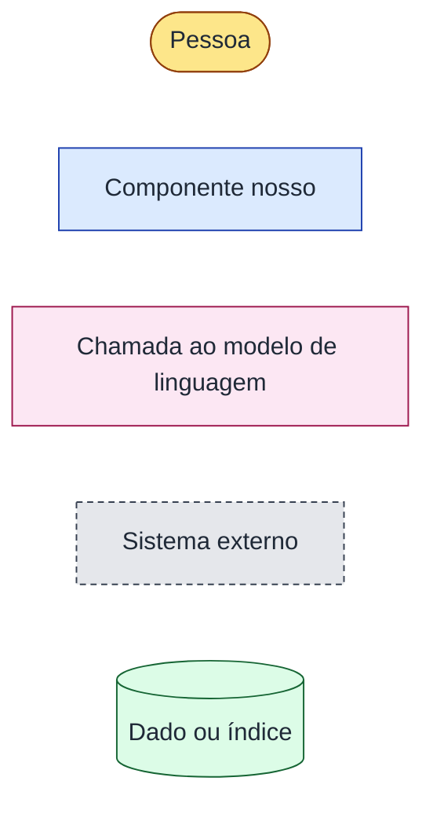

## 1. Contexto

Quem usa a Dona Checa e com quais sistemas ela conversa (nível 1 do modelo
C4).

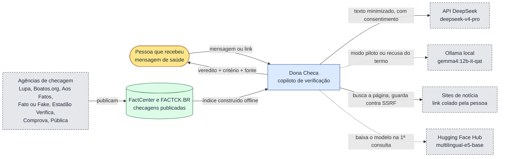

Origem: `interface/config.py`, `prototipo/verificacao/modelo.py`,
`prototipo/entrada/rede.py`, `prototipo/rag/densa.py`,
`prototipo/resposta/agencias.py`.

## 2. Contêineres

O que roda e onde (nível 2 do C4). Um único processo Python serve a página e
roda o fluxo; o índice fica inteiro em memória, sem banco vetorial.

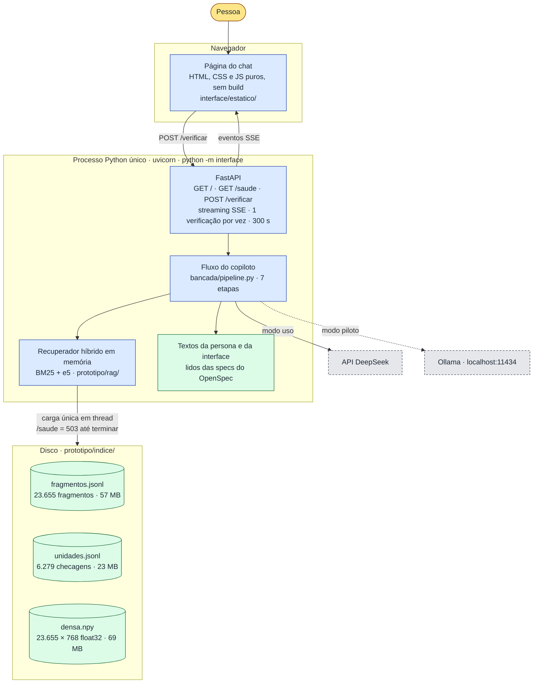

Origem: `interface/app.py`, `interface/__main__.py`, `interface/fluxo.py`,
`prototipo/rag/__main__.py` (`carregar`), `prototipo/indice/manifesto.json`.

## 3. Fluxo das sete etapas

O caminho de uma mensagem. Em rosa, as etapas que chamam o modelo de
linguagem. Cada losango é uma saída antecipada: o fluxo para ali e a página
recebe o motivo.

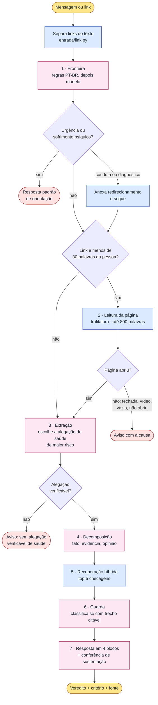

Origem: `bancada/pipeline.py` (`executar`, `ETAPAS`, `PALAVRAS_TEXTO_CURTO`),
`prototipo/verificacao/fronteira.py`, `prototipo/entrada/leitura.py`,
`prototipo/verificacao/extracao.py`.

## 4. Sequência de uma verificação

O que acontece entre o clique em «Verificar» e a resposta na tela. A página
recebe um evento por etapa, então a pessoa vê o andamento.

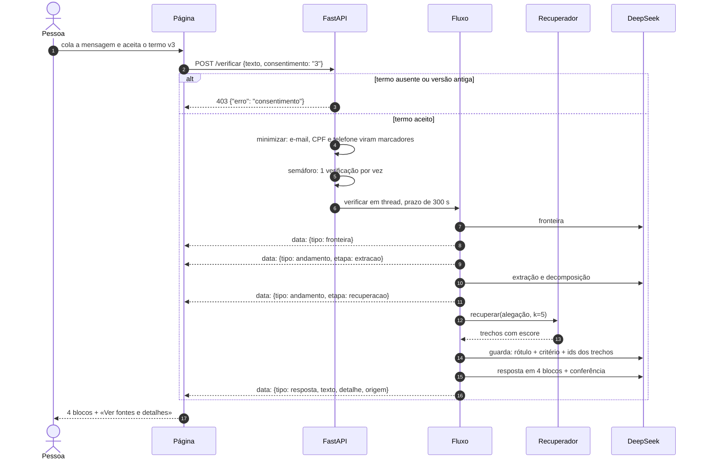

Origem: `interface/app.py` (`gerador_do_pedido`, `Semaphore(1)`,
`TERMO_VERSAO`), `interface/fluxo.py` (`verificar`),
`prototipo/entrada/minimizar.py`.

## 5. Recuperação híbrida

Como a alegação vira as cinco checagens que a guarda vai ler. Dois braços
pontuam em paralelo; cada escore é normalizado contra a própria distribuição
da consulta antes da fusão.

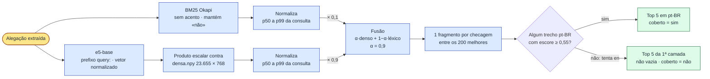

Na aferição com 20 consultas reais, a fusão teve Recall@5 de 1,00 e MRR de
0,897, contra 0,725 de MRR do BM25 sozinho.

Origem: `prototipo/rag/hibrida.py` (`ALFA_PADRAO`, `LIMIAR_EVIDENCIA`,
`PRIORIDADE_IDIOMA`, `recuperar`), `prototipo/rag/lexica.py`,
`prototipo/rag/densa.py`; números em
[Protótipo e avaliação](act/prototipo-avaliacao.md).

## 6. Guarda e resposta: veredito nunca nu

Onde o código impede veredito sem fonte. O modelo propõe o rótulo; o código
decide se ele sobrevive.

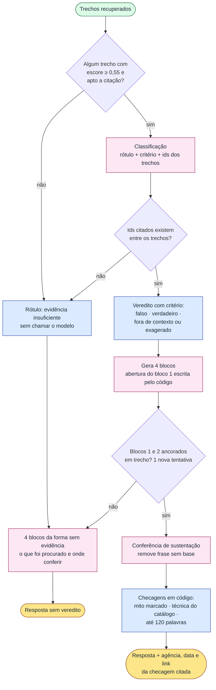

Os quatro blocos com evidência: **veredito**, **o que se sabe**, **por que
essa mensagem engana** e **o que observar da próxima vez**.

Origem: `prototipo/verificacao/guarda.py`,
`prototipo/verificacao/classificacao.py`, `prototipo/resposta/estrutura.py`
(`COM`, `SEM`, `ABERTURA`), `prototipo/resposta/conferencia.py`,
`prototipo/resposta/ancoragem.py`, `prototipo/resposta/mito.py`.

## 7. Pipeline de dados

Como as checagens publicadas viram o índice. Roda offline, uma vez, com
`python -m prototipo.rag construir`.

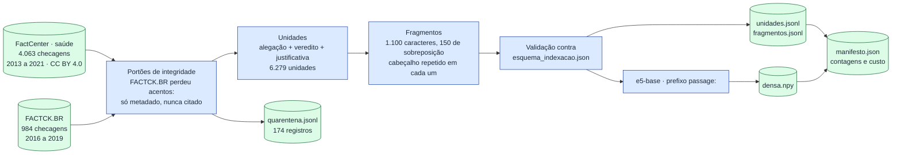

Nenhum modelo é treinado: o dataset é acervo para citar, não alvo de
classificador.

Origem: `prototipo/rag/__main__.py` (`construir`), `prototipo/rag/corpus.py`,
`prototipo/rag/unidades.py`, `prototipo/indice/manifesto.json`.

## 8. Avaliação

Como o grupo mede sem gastar API a cada teste. A bancada grava as chamadas ao
modelo e à rede e as repete offline; a mesma função `executar` serve a bancada
e o chat.

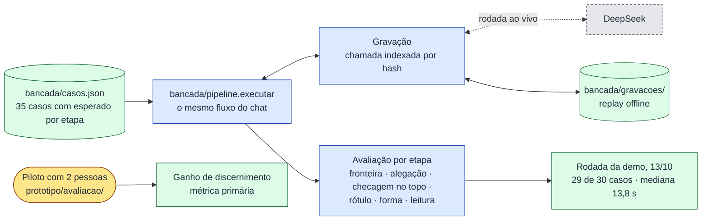

Origem: `bancada/gravacao.py`, `bancada/avaliacao.py`, `bancada/casos.json`;
números em [Protótipo e avaliação](act/prototipo-avaliacao.md#rodada-da-demo).

## 9. Implantação

Estado em 15/10/2026: o chat roda na máquina de quem apresenta, e só o
portfólio é publicado. A hospedagem pública do chat é tratada em change
próprio.

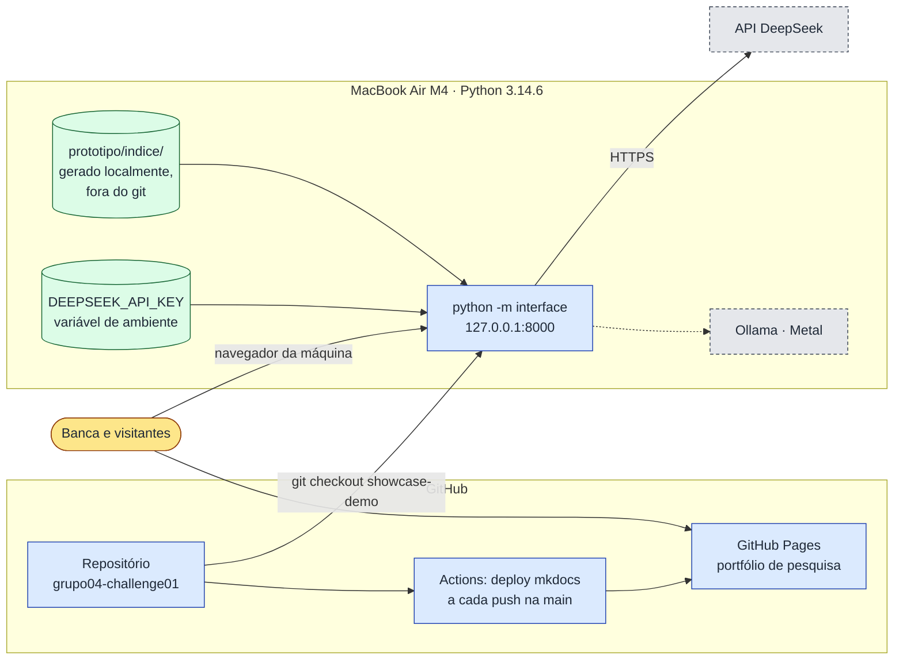

Origem: `.github/workflows/deploy.yml`, `interface/config.py`
(`DONA_CHECA_HOST`), `.gitignore`.

## 10. Pacotes

Quem importa quem. O fluxo em `bancada/` é o centro: o chat e a bancada usam
a mesma função.

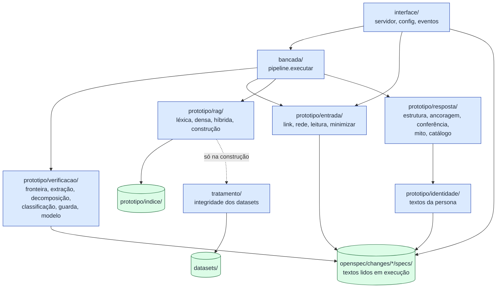

Origem: imports de `interface/app.py`, `interface/fluxo.py`,
`bancada/pipeline.py`, `prototipo/rag/corpus.py`.
